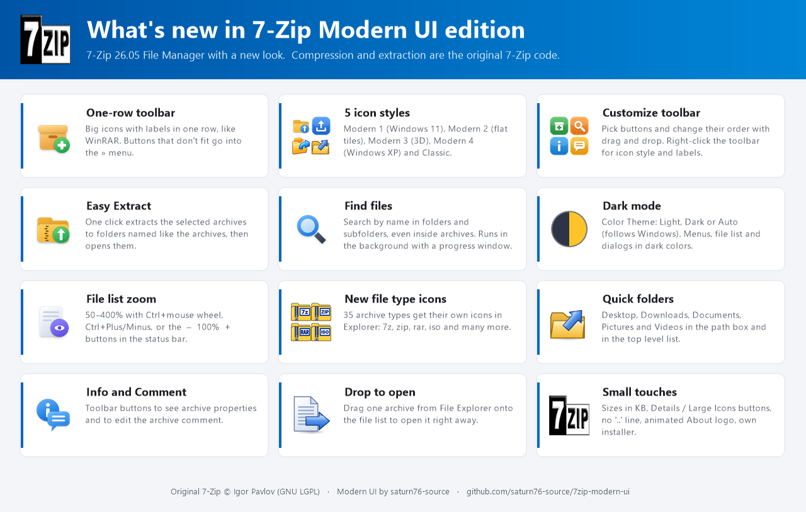
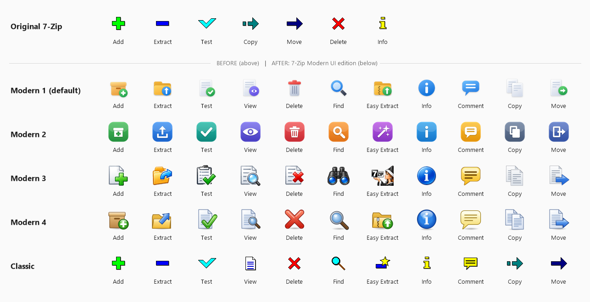

# 7-Zip Modern UI edition

A modified **7-Zip 26.05 File Manager** (`7zFM.exe`, Windows x64) with a new, modern user interface.
Only the user interface was changed. Compression and extraction code is the original 7-Zip code.

## Toolbar icons: before and after

## Features

- **One-row toolbar** with big icons and labels. Buttons that don't fit go into the `»` menu.
- **5 icon styles:** Modern 1 (Windows 11 style, default), Modern 2 (flat tiles), Modern 3 (3D), Modern 4 (Windows XP style) and Classic.
- **Customize Toolbar** window: choose buttons and change their order with drag and drop. Right-click the toolbar for icon style and labels.
- **Easy Extract:** one click extracts the selected archives to folders named like the archives, then opens them.
- **Find files:** search by name in folders and subfolders, even inside archives, with a progress window.
- **Color Theme:** Light, Dark or Auto (follows Windows).
- **File list zoom** 50-400%: Ctrl+mouse wheel, Ctrl+Plus / Ctrl+Minus / Ctrl+0, or the `-` `100%` `+` buttons in the status bar.
- **35 new file type icons** for 7z, zip, rar, iso and other archive types.
- **Quick folders:** Desktop, Downloads, Documents, Pictures and Videos in the path box and the top level list.
- **Info and Comment** toolbar buttons.
- **Drop to open:** drag one archive from File Explorer onto the file list to open it.
- Sizes in KB, Details / Large Icons buttons in the status bar, no `..` line by default, animated About logo.

## Download

Download the installer from the [Releases](../../releases) page.

## Build

Requirements: Windows, Visual Studio 2022 or newer with the C++ desktop workload.

- `build_7zFM.cmd` - full build with nmake. Output: `CPP\7zip\Bundles\Fm\x64\7zFM.exe`
- `7zFM-Toolbar.sln` - open in Visual Studio and use **Build** (runs `vs_build.cmd`).
- `build_installer.cmd` - makes the installer with [NSIS](https://nsis.sourceforge.io).

Close a running 7zFM.exe before building. After changing a `.h` or `.rc` file, do a full rebuild (delete the `x64` folder).

All changes are in `CPP\7zip\UI\FileManager`. The branch history shows every change on top of the original 7-Zip 26.05 (`main`).

## License and credits

- **7-Zip** Copyright (C) Igor Pavlov - [7-zip.org](https://7-zip.org) - GNU LGPL (see `DOC\License.txt`).
- **Modern UI modifications** by saturn76-source, under the same license.

This is not an official 7-Zip release.
